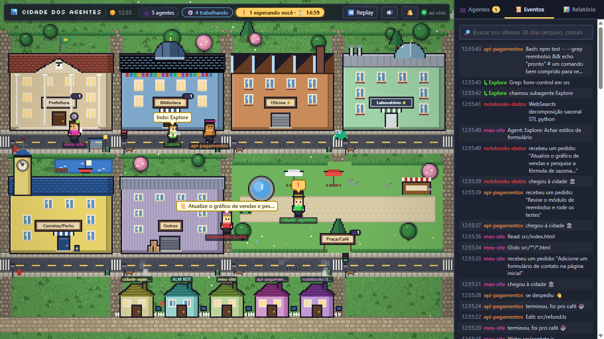

# 🏙️ Cidade dos Agentes

Uma mini cidade em pixel art no navegador que mostra, em tempo real, o que seus agentes do
Claude Code estão fazendo. Alimentada por hooks, roda 100% local e **não gasta nenhum token**:
é só código Node.js + canvas.



> Projeto independente, **sem ligação com a Anthropic**. Ele usa os *hooks* do Claude Code, cujo
> formato pode mudar com o tempo.

- Node.js puro, **sem dependências** (nada de `npm install`).
- Servidor escuta apenas em `127.0.0.1`, porta **4777** por padrão.
- Tempo real via Server-Sent Events (SSE).

## Requisitos

- **Windows 10 ou 11.** O botão de abrir pastas usa o Explorer, as notificações são as do
  Windows e o início automático usa um arquivo `.vbs`.
- [Node.js](https://nodejs.org) (versão atual LTS).
- [Claude Code](https://claude.com/claude-code), para gerar os eventos reais. Sem ele você ainda
  vê a cidade com o simulador.

## Como rodar

```powershell
git clone https://github.com/dalmeidasdev/cidade-agentes.git
cd cidade-agentes
node server.js
```

Abra **http://localhost:4777** no navegador.

### Ver a cidade sem usar o Claude Code

Com o servidor rodando, em outro terminal:

```powershell
node test-events.js          # roteiro de ~50 s: três sessões, subagentes e um pedido de permissão
node test-events.js --loop   # repete até Ctrl+C
```

O script entrega os eventos ao `hook.js` pelo stdin, igual ao Claude Code. Assim ele testa o
caminho todo.

## Deixar a cidade sempre ligada

Se o servidor não estiver rodando, os hooks não atrapalham o Claude Code, mas nada é registrado
(sem histórico, relatório nem conquistas). Para a cidade ligar sozinha quando você entra no
Windows:

```powershell
node install-autostart.js              # instala e já liga a cidade agora
node install-autostart.js --uninstall  # deixa de ligar sozinha
```

Isso cria só um arquivo: `cidade-agentes.vbs` na pasta Inicializar do seu usuário
(`%APPDATA%\Microsoft\Windows\Start Menu\Programs\Startup`). Ele roda o `launcher.js` sem abrir
janela. Não usa admin, registro nem serviços.

- **Abrir a cidade:** dê dois cliques em `iniciar-cidade.cmd`. Ele liga o servidor se precisar
  e abre o navegador.
- **Log do servidor:** `data\server.log` (zera sozinho quando passa de 1 MB). Cada execução do
  launcher deixa uma linha, por exemplo `launcher (login): já estava rodando`. A origem pode ser
  `login`, `atalho` ou `manual`, então dá para conferir se o autostart rodou.
- **Parar o servidor:**
  ```powershell
  Get-CimInstance Win32_Process -Filter "Name='node.exe'" | Where-Object { $_.CommandLine -match 'cidade-agentes.server\.js' } | ForEach-Object { Stop-Process -Id $_.ProcessId }
  ```
  Você também pode encerrar o `node.exe` pelo Gerenciador de Tarefas.

## Instalar os hooks

O `install-hooks.js` lê o `settings.json`, **mescla** as entradas novas preservando tudo o que já
existe (inclusive outros hooks) e salva um backup em `settings.json.bak` antes de gravar.
Pode rodar de novo sem duplicar nada.

```powershell
# Global: vale para todas as sessões (%USERPROFILE%\.claude\settings.json)
node install-hooks.js --global

# Só em um projeto (<caminho>\.claude\settings.json)
node install-hooks.js --project C:\caminho\do\projeto
```

Para desinstalar (remove **só** as entradas que o script adicionou):

```powershell
node install-hooks.js --global --uninstall
node install-hooks.js --project C:\caminho\do\projeto --uninstall
```

Depois de instalar, abra uma sessão nova do Claude Code (ou confira em `/hooks`).

Eventos instalados: `SessionStart`, `UserPromptSubmit`, `PreToolUse`, `PostToolUse`,
`PostToolUseFailure`, `SubagentStart`, `SubagentStop`, `Notification`, `Stop`, `SessionEnd`.

Cada hook é registrado assim:

```json
{ "type": "command", "command": "node \"C:/.../cidade-agentes/hook.js\"", "async": true, "timeout": 5 }
```

- `async: true` faz o hook rodar em segundo plano, sem bloquear o Claude Code.
- O `hook.js` tem timeout de 500 ms para o POST. Se o servidor estiver desligado, ele sai
  com código 0 sem imprimir nada.
- Só é enviado um resumo: nome do evento, sessão, agente, ferramenta, pasta e um resumo curto
  da ação (caminho do arquivo ou os primeiros 80 caracteres do comando). O conteúdo de arquivos
  nunca é enviado.

## Mudar a porta

```powershell
$env:CIDADE_PORT=5000; node server.js
```

O `hook.js` também lê `CIDADE_PORT`. Se você mudar a porta, defina a variável de forma
permanente para o Claude Code também enxergar:

```powershell
[Environment]::SetEnvironmentVariable('CIDADE_PORT', '5000', 'User')
```

(ou use a chave `"env": { "CIDADE_PORT": "5000" }` no `settings.json` do Claude Code).

## O que cada prédio representa

| Prédio | Ferramentas / eventos |
|---|---|
| 🏛️ Prefeitura | SessionStart, UserPromptSubmit, Agent/Task (delegando para subagentes) |
| 📚 Biblioteca | Read, Grep, Glob |
| 🔨 Oficina | Edit, Write, MultiEdit, NotebookEdit |
| 🧪 Laboratório | Bash |
| 📮 Correios/Porto | WebFetch, WebSearch, qualquer `mcp__*` |
| 🏚️ Outros | qualquer outra ferramenta |
| ☕ Praça/Café | agentes ociosos (depois do Stop) |

- Cada sessão vira um habitante com cor própria e o nome da pasta (`cwd`).
- Subagentes são habitantes menores (de boné), ligados ao pai por uma linha tracejada. No
  `SubagentStop` eles vão para casa (saem pela esquerda).
- `Notification` mostra um "❗" piscando (normalmente é pedido de permissão).
- `Stop`: o habitante vai para a Praça/Café. `SessionEnd`: dá tchau e vai embora.
- Acima da cabeça aparece só um ícone de estado (⚙️ trabalhando, ❗ esperando, 💤 dormindo).
  O balão com a ação completa aparece nos primeiros segundos, ao passar o mouse ou para o
  agente selecionado.
- A luz da cidade segue o relógio: amanhecer, dia, entardecer e noite (com postes acesos).

## Usando a cidade

- **Clique num habitante** (ou no cartão dele na aba 👥 Agentes) para abrir o **perfil**:
  título pela atividade (📚 Rato de biblioteca, 🔨 Mão na massa, 🧪 Cientista, 📮 Pombo-correio,
  🏛️ Delegador), estado atual, pasta, sessão, contadores, ferramentas mais usadas, arquivos
  recentes, último pedido, subagentes e linha do tempo.
  - Clique no nome para dar um **apelido**. Ele fica salvo no navegador, por pasta.
  - **📍 Ir até** destaca o habitante; **🗑 Esquecer** remove o perfil da cidade.
- **Clique num prédio** para **entrar**. Cada prédio tem uma sala com estações de trabalho, e
  quem está lá aparece trabalhando: o terminal do Laboratório mostra os últimos comandos, o
  mural da Prefeitura mostra o último pedido, a Oficina solta faíscas... O painel mostra quem
  está lá dentro e o histórico do prédio. Para sair: **Esc**, a porta ou "← Voltar à cidade".
- Abas do painel: **👥 Agentes**, **📜 Eventos** (dá para filtrar pelo agente selecionado) e
  **📊 Hoje** (contadores e visitas por prédio).

### Alertas: quando um agente precisa de você

Cada alerta explica **o quê**, **onde** e **como responder**:

- **O quê:** a ação que está esperando sua aprovação, por exemplo
  `Quer usar Bash: npm run deploy`. Se foi um subagente que pediu, ele aparece entre parênteses.
- **Onde:** o programa em que a sessão roda (terminal do VS Code, Windows Terminal, app
  Claude Desktop…), a pasta (com botão de copiar) e a hora em que a sessão abriu. Isso ajuda
  quando há várias janelas abertas na mesma pasta.
- **Como:** o passo a passo para cada tipo de alerta:

| Tipo | O que significa |
|---|---|
| `permission_prompt` | pede permissão: aprove ou recuse na janela da sessão |
| `idle_prompt` | terminou e espera sua próxima mensagem |
| `elicitation_dialog` | um servidor MCP abriu um formulário para preencher |
| `elicitation_url_dialog` | um servidor MCP pede para abrir um link (por exemplo, login) |
| `agent_needs_input` | um agente parou esperando sua resposta |

Avisos informativos (`auth_success`, `agent_completed`, avisos de cota…) não viram ❗: aparecem
só num toast curto, sem som.

Onde o alerta aparece:

- **toast** no topo com o resumo; clique para abrir o cartão completo no perfil do agente;
- chip "❗ esperando você" e título da aba `(1❗) Cidade dos Agentes`;
- **bip** curto. Liga e desliga no botão 🔊. O navegador só libera som depois do primeiro
  clique na página;
- **notificação do Windows** se você ligar no botão 🔔. Ela só aparece quando a aba está em
  segundo plano e fica na tela até você clicar.

O alerta some sozinho assim que a sessão volta a andar (você respondeu).

### Tempo das ações

- Ação rodando há mais de 30 s ganha um selo **⏱ 1:23** sobre o agente. Ele fica âmbar depois
  de 2 min.
- O chip do topo mostra há quanto tempo alguém espera você (`⏳ 2:10`).
- No perfil aparecem: "rodando há…", o tempo gasto por ferramenta, as ações mais lentas e
  quanto tempo o agente esperou você.

### 📊 Relatório

A aba **Relatório** mostra o dia selecionado (hoje e os 6 anteriores):

- ações, tempo ativo, falhas e tempo esperando você;
- gráfico de **atividade por hora**, empilhado por tipo (leitura, edição, comando, web,
  outros), com opção de ver como tabela;
- **tempo ativo por projeto** (soma dos intervalos de até 5 min entre eventos da sessão);
- os últimos 7 dias;
- arquivos mais editados e mais lidos;
- ações mais lentas, falhas (com o erro) e subagentes por tipo;
- a grade de **🏆 Conquistas**.

### ⏪ Replay

O botão **⏪ Replay** revê qualquer um dos últimos 7 dias:

- ▶/⏸, velocidade 1×/10×/60× e um slider para pular para qualquer horário;
- pausas longas sem eventos são puladas;
- **● Ao vivo** volta ao presente;
- os alertas reais continuam chegando durante o replay.

### 🏘️ Bairro dos projetos

Embaixo da cidade fica a **Rua dos Projetos**: uma casinha por pasta de projeto, com a cor do
projeto.

- A sessão sai de casa ao começar e volta para casa ao encerrar.
- A janela acende quando há sessão ativa.
- A bandeirinha da caixa de correio sobe quando alguém do projeto espera você.
- Clique na casa para ver o projeto: sessões, números de hoje e da semana, e um link para o
  relatório só daquele projeto.

### Vida na cidade e acessórios

- Carros circulam pelas avenidas (mais carros quando há mais agentes trabalhando), pássaros
  cruzam o céu e pombos fogem de quem passa pela praça.
- Uma **falha** põe fogo e fumaça no prédio da ferramenta por 20 s. **3 falhas em 10 min**
  fazem chover (também nas janelas dos interiores).
- Subagentes usam acessórios conforme o tipo:

  | Tipo | Acessório |
  |---|---|
  | Explore | lupa |
  | Plan | prancheta |
  | revisor | óculos |
  | teste | tubo de ensaio |
  | general-purpose | mochila |
  | outros | boné |

- As sessões principais usam um chapéu na cor do projeto.

### 🔎 Busca no histórico

Na aba **📜 Eventos**, o campo de busca procura nos últimos 30 dias por nome de arquivo,
comando, projeto, erro ou tipo de subagente (ex.: `checkout.ts`, `npm test`, `timeout`). Clique
num resultado para abrir o **replay pausado naquele momento**.

### 📝 Resumo em texto

Na aba **📊 Relatório**, o botão **📝 Resumo em texto** gera um resumo em Markdown do dia (ou
do projeto filtrado). Ele traz o tempo ativo, as ações, as falhas e, para cada projeto, os
pedidos, os arquivos editados e as falhas. Dá para **copiar** ou **baixar .md**, bom para colar
no daily.

### 📂 Abrir pasta / VS Code

O perfil do agente, o cartão de alerta e a vista do projeto têm os botões **📂 Abrir pasta**
(Explorer) e **🧑‍💻 VS Code** (este só aparece se o VS Code estiver instalado).

Por segurança, o servidor:
- só abre pastas que a cidade já conhece (projetos e sessões vistos);
- nunca usa um shell;
- só aceita o pedido vindo da própria página da cidade, então outros sites abertos no
  navegador não conseguem usar a rota.

### 🏗️ Cidade que cresce

Cada prédio sobe de nível (★ a ★★★★) conforme o uso acumulado: a Biblioteca pelas leituras, a
Oficina pelas edições, o Laboratório pelos comandos, e assim por diante. Os limites são 50, 200,
500 e 1500; a praça cresce pelos dias com atividade.

| Nível | O que muda |
|---|---|
| 1 | floreiras nas janelas |
| 2 | torre/anexo |
| 3 | varal de luzinhas |
| 4 | telhado dourado e nome novo (Fábrica, Grande Biblioteca, Centro de Pesquisa…) |

A praça ganha flores, coreto, bancos e uma fonte maior. A vista do prédio mostra quanto falta
para o próximo nível. Quando um prédio sobe de nível, aparece um aviso e uma festinha. As
regras ficam em `GROWTH` em `public/buildings.js`.

### 🎆 Festa nas conquistas

Ao desbloquear uma conquista, a cidade solta fogos de artifício e confete por alguns segundos.

### 🏆 Conquistas

Medalhas como Mestre de obras (100 edições), Coruja, Madrugador, Dia limpo, Sequência de 5
dias, Resposta rápida (permissão respondida em menos de 10 s), Paciência (ação de 5 min ou
mais) e Bairro cheio. Cada uma aparece com um toast dourado e um som curto. A lista e as regras
ficam em `achievements.js`.

## Dados salvos

O servidor guarda tudo localmente em `data/`:

- `data/state.json`: perfis, histórico dos prédios, projetos, contadores, conquistas e os
  últimos 50 eventos;
- `data/events/AAAA-MM-DD.jsonl`: todos os eventos de cada dia, que alimentam o relatório e o
  replay. Ficam guardados por 30 dias e trazem só os resumos que o hook manda (caminho do
  arquivo, os primeiros 80 caracteres do comando, os primeiros 60 do pedido), nunca o
  conteúdo de arquivos. Por isso a cidade se reconstrói mesmo depois de reiniciar o
  servidor;
- perfis de sessões encerradas há mais de 24 h, ou sem sinal há 7 dias, são apagados sozinhos.

Para zerar tudo, pare o servidor e apague a pasta `data`. Se o arquivo corromper, o servidor o
renomeia para `state.json.corrupt` e começa do zero.

### 🔒 Privacidade

- Tudo fica **na sua máquina**. O servidor só escuta em `127.0.0.1` e nada é enviado para a
  internet.
- Mesmo sendo só um resumo, os primeiros 80 caracteres de um comando podem conter algo
  sensível, como um token colado numa linha de comando. Por isso a pasta `data/` está no
  `.gitignore`: **nunca a envie para o GitHub nem a compartilhe**.
- Os hooks podem ser removidos a qualquer momento com
  `node install-hooks.js --global --uninstall`.

O simulador usa sessões `simulado-*`. Elas aparecem ao vivo, mas **não** entram no
histórico, nos relatórios nem nas conquistas. Para tirá-las da tela: `node test-events.js --limpar`.

APIs locais (úteis para depurar): `/api/state`, `/api/report?day=AAAA-MM-DD&project=<pasta>`, `/api/search?q=<texto>`,
`/api/week` e `/api/events?day=AAAA-MM-DD`.

`GET http://localhost:4777/api/state` mostra todo o estado em JSON (útil para depurar).

## Mudar o visual

O desenho da cidade fica em `public/art.js`:

| O que | Onde |
|---|---|
| Paleta geral (grama, asfalto, calçada, contornos, vidros…) | objeto `PAL` |
| Cores de cada prédio | `wall`/`roof` em `public/buildings.js` |
| Formato de cada prédio | uma função por prédio em `DRAWERS` (prefeitura com frontão e colunas, biblioteca com cúpula, oficina com telhado de fábrica, laboratório com cúpula de vidro, correios com torre do relógio, armazém) |

Um prédio novo sem função própria usa uma caixa padrão.

- **Chão, ruas, calçadas e cercas vivas:** desenhados uma vez numa camada em cache (`rebuild()`)
  e só copiados a cada quadro.
- **Luz da noite:** um mapa de luz (escuridão com "buracos" nos postes, janelas, faróis e
  fogo) em `applyLighting()`.
- **Vinheta e gradação de cor:** em `postFx()`.
- **Sombras:** seguem a hora do dia.
- **Habitantes:** o sprite (cerca de 16 px, com contorno, caminhada em 4 quadros, piscada e
  ferramenta na mão ao trabalhar) fica em `drawPersonAt()` no `public/city.js`.

## Adicionar prédios ou sprites

1. **Novo prédio:** em `public/buildings.js` (usado pelo navegador e pelo servidor),
   acrescente uma entrada em `BUILDINGS`:
   ```js
   estadio: { name: 'Estádio', icon: '🏟️', wall: '#ccc', roof: '#a33', tools: ['MinhaFerramenta'],
              about: 'Descrição que aparece no painel.' },
   ```
   Use `match: (nome) => nome.startsWith('algo')` para casar ferramentas por padrão.
   Depois dê uma posição a ele em `LAYOUT` (`col` de 0 a 3, `row` 0 ou 1, `span` opcional).
   Se precisar de mais espaço, aumente `COLS`.
2. **Sala do prédio:** em `public/interiors.js`, acrescente uma entrada em `THEMES` com as
   cores (`wall`, `wallDark`, `floorA`, `floorB`) e, se quiser, as funções `decorate`
   (parede e fundo), `desk` (móvel de cada estação), `tick` (efeitos) e `overlay` (textos).
   Sem tema, o prédio usa uma sala padrão.
3. **Sprite no lugar do desenho:** coloque a imagem em `public/` (por exemplo
   `public/sprites/oficina.png`) e adicione `sprite: 'sprites/oficina.png'` ao prédio. A imagem
   é esticada no retângulo do prédio sem suavização, então pixel art fica nítida.
4. **Habitantes:** o desenho fica em `drawPersonAt()` (`public/city.js`), usado na cidade, nos
   interiores e nos avatares do painel. Troque os `px(...)` por um `drawImage(...)` para
   usar uma spritesheet.

## Arquivos

```
server.js            servidor HTTP + SSE (porta 4777, só 127.0.0.1)
profiles.js          perfis, projetos, tempos e gravação em data/ (state.json + events/)
reports.js           relatórios do dia/semana a partir de data/events/*.jsonl
achievements.js      conquistas e contadores da vida toda
hook.js              chamado pelo Claude Code; envia o resumo do evento
install-hooks.js     instala/desinstala os hooks no settings.json
launcher.js          liga o servidor em segundo plano (se ainda não estiver rodando)
install-autostart.js faz a cidade ligar sozinha ao entrar no Windows
iniciar-cidade.cmd   atalho: liga e abre a cidade
test-events.js       simulador de eventos (--loop, --limpar)
public/index.html    página, HUD e estilos
public/buildings.js  prédios e regras ferramenta → prédio (compartilhado com o servidor)
public/city.js       núcleo: estado, conexão, cena da cidade, habitantes, cliques
public/art.js        visual: paleta, chão em cache, prédios, casas, sombras, luz
public/interiors.js  salas dos prédios
public/hud.js        painel, perfis, projetos, toasts, som e notificações
public/report.js     aba Relatório (gráficos e conquistas)
public/replay.js     replay do dia
data/                estado salvo e histórico (criado automaticamente)
```

## 🤖 Uso de IA

Este projeto foi feito com apoio do Claude Code. Eu defini a ideia e os requisitos, testei tudo
no meu próprio computador e ajustei o que não funcionou.

## 📄 Licença

[MIT](LICENSE) © Diego Almeida
